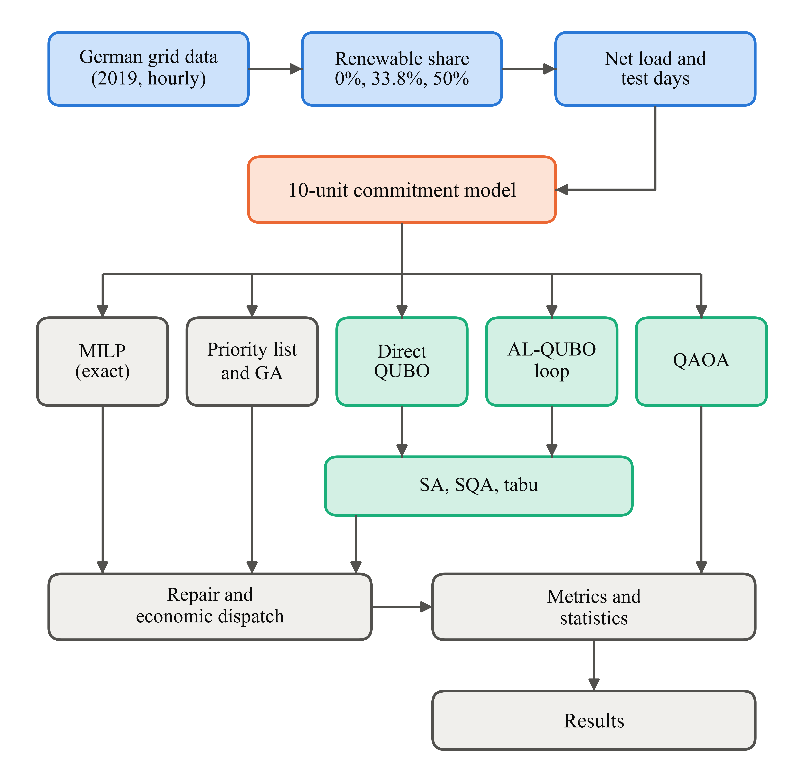

# Quantum annealing for day-ahead unit commitment: a year-long QUBO benchmark on German grid data

Code, processed data and per-day results for the book chapter

> [Author names]. *Quantum Annealing for Day-Ahead Unit Commitment under Real Renewable Variability: A Year-Long QUBO Benchmark on German Grid Data.* In: A. D. Oza, A. Patel, K. Bhatia, C. Desai (Eds.), *Emerging Technologies in Engineering*. Bentham Science Publishers, [year]. [DOI when available]

The benchmark compares two QUBO encodings of day-ahead unit commitment against an exact MILP reference:
- a **direct QUBO**, with commitments and K-bit outputs in one model;
- a **commitment-only augmented-Lagrangian QUBO (AL-QUBO)**, with classical economic dispatch.

Each runs on 156 day instances: 52 held-out days of 2019 German load, wind and solar data at renewable shares of 0%, 33.8% (actual) and 50%. The 10-unit test system is from Kazarlis et al. (1996). The QUBOs are sampled by simulated annealing (SA), simulated quantum annealing (SQA, path-integral Monte Carlo) and tabu search. Single-hour instances are also solved by QAOA in exact state-vector simulation.



## Repository layout

```
code/      model, solvers, experiments, analysis and figure scripts
data/      DE_2019_hourly.csv: processed 2019 hourly load, solar and wind (MW)
results/   raw per-day results (JSONL/JSON) and the summary tables used in the chapter
figures/   chapter figures (PNG, 600 dpi)
```

| Chapter item | File | Produced by |
|---|---|---|
| Fig. 1 workflow | `figures/Fig1_workflow.png` | `code/fig1_workflow.py` |
| Fig. 2 net load | `figures/Fig2_netload.png` | `code/fig2_netload.py` |
| Table 3 methods and budgets | `results/E1_main_config.json` | settings used by `code/run_main.py` |
| Fig. 3 gaps, Tables 4–7 | `figures/Fig3_gaps.png`, `results/T4_gaps.csv`, `T5_wilcoxon.csv`, `T6_raw_dqubo.csv`, `T7_spearman.csv`, `T7b_partial.csv` | `code/analyze.py` (reads `results/E1_main.jsonl`) |
| Fig. 4 load vs gap | `figures/Fig4_load_vs_gap.png` | `code/fig4_load_vs_gap.py` |
| Fig. 5, Table 8 sensitivity (K = 1–7, α = 0.1–3) | `figures/Fig5_sensitivity.png`, `results/T8_sens.csv` | `code/run_sens.py`, `code/summarize_sens.py`, `code/fig5_sensitivity.py` |
| Fig. 6, Table 9 QAOA | `figures/Fig6_qaoa.png`, `results/E5_qaoa.json`, `T9_qaoa.csv` | `code/run_qaoa.py`, `code/fig6_qaoa.py` |
| Calibration (Section 5.4) | `results/E0_direct_qubo_penalty_grid_calib.txt` | `code/calib_*.py` |

## Data

`data/DE_2019_hourly.csv` comes from the Open Power System Data time-series package, version 2020-10-06 (Wiese et al., *Applied Energy* 236 (2019) 401–409). It covers Germany, 1 Jan–31 Dec 2019, hourly, local time, and has three columns:
- `load_MW`: ENTSO-E actual load;
- `solar_MW`: actual solar generation;
- `wind_MW`: onshore plus offshore wind generation.

The one hour lost at the spring clock change is linearly interpolated.

The raw file (about 126 MB) is not stored here because it exceeds GitHub's file-size limit. To rebuild the processed file from it:

1. Download `time_series_60min_singleindex.csv` from
   https://data.open-power-system-data.org/time_series/2020-10-06/
   and save it as `data/opsd_60min.csv`.
2. Run `python code/prep_data.py`.

Please cite Open Power System Data when you use the data, and check their terms of use.

## Installation

Python 3.11 was used.

```
pip install -r requirements.txt
```

## Reproducing the results

Run from the repository root. The times below are for one desktop CPU with 8 logical cores; the scripts use 7 worker processes.

| Step | Command | Output | Approx. time |
|---|---|---|---|
| Main benchmark (156 days × 7 methods, 3 seeds) | `python code/run_main.py` | `results/E1_main.jsonl` | 2 h |
| Tables 4–7, Fig. 3 | `python code/analyze.py` | `results/T4–T7*.csv`, `figures/Fig3_gaps.png` | 1 min |
| Sensitivity sweep (1,456 runs) | `python code/run_sens.py` then `python code/summarize_sens.py` | `results/E23_sens.jsonl`, `T8_sens.csv` | 1.5 h |
| QAOA (12 instances, p = 1–5) | `python code/run_qaoa.py` | `results/E5_qaoa.json` | 1 h |
| Figures | `python code/fig1_workflow.py` … `fig6_qaoa.py` | `figures/` | 1 min |

`run_main.py` can be resumed: it skips day instances already in `results/E1_main.jsonl`. The analysis and figure scripts need only the stored results, so the tables and figures can be regenerated without rerunning the solvers. Seeds are fixed, and the solver settings used are in `results/E1_main_config.json`.

## Main components (`code/uc_core.py`)

- **Test system:** the Kazarlis 10-unit data, initial status, and 10% spinning reserve.
- **Day selection:** `test_days()` gives the 52 test days; `calib_days()` gives the 8 separate calibration days.
- **Direct QUBO:** the `Qubo` class.
- **AL-QUBO:** `al_qubo` and `hybrid_solve`.
- **MILP reference:** `solve_milp` (HiGHS via SciPy).
- **Simulated quantum annealing:** `sqa_solve`, a Numba path-integral Monte Carlo sampler.
- **Classical baselines:** `ga_solve` (genetic algorithm) and `priority_list`.
- **Shared evaluator:** `evaluate`, which runs greedy reserve repair, then exact quadratic economic dispatch, then costing with start-ups.

## Notes

- All quantum methods run on classical simulators; no quantum hardware was used.
- Run times depend on the machine and are reported in the chapter for orientation only.
- The code was written with the help of an AI assistant (Claude, Anthropic), as declared in the chapter.

## License

The code is released under the MIT License (see `LICENSE`). The data in `data/` is derived from Open Power System Data and remains subject to its original terms.

## Citation

Please cite the chapter above when using this code or these results.
